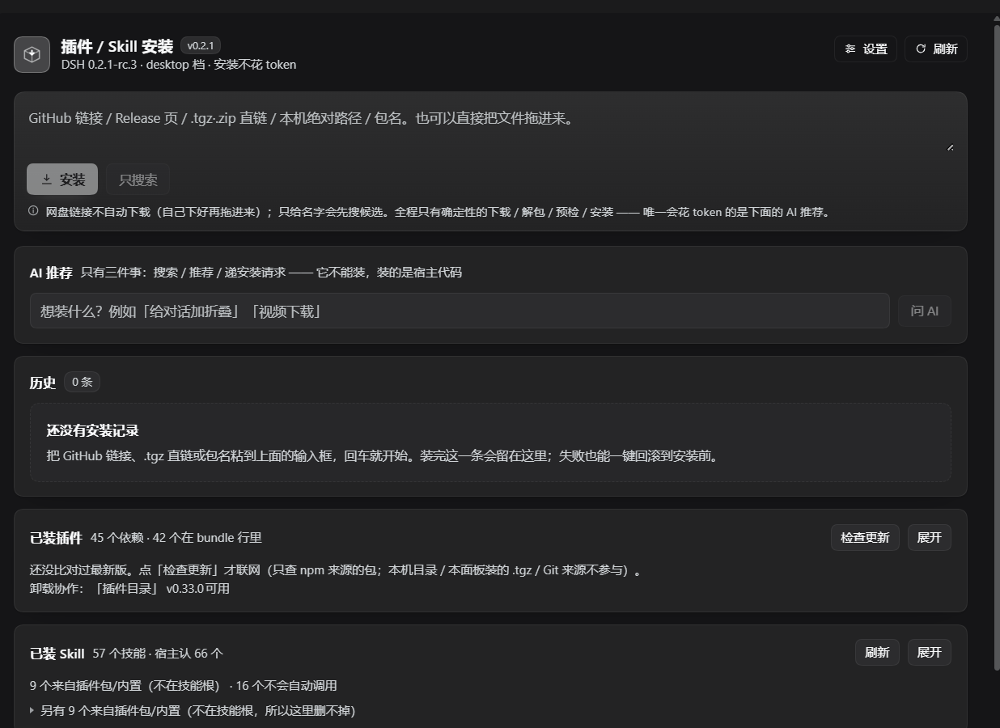

# dsh-plugin-installer · Plugin / Skill Install Panel

[中文](README.md)

> **Status: development build — not a final release.** Released as-is from daily use; features and UI
> **change from time to time** (the install pipeline, settings and the data directory may change too).
> Check the DSH version range below before installing.
>
> **状态：开发版，非最终版本。** 功能与界面会不定期更新，安装流水线、配置项与数据目录都可能变。



> **Where to open it after installing**: restart DSH, then look in the left sidebar for a **rounded square with a
> downward arrow** (label "插件安装"), listed among your other panel icons. Click it and the main area switches to this panel.
> If you cannot find it: sidebar **Settings → Plugins**, search `dsh-plugin-installer`, and make sure it is enabled —
> the plugin tree is read at startup, so **DSH must be restarted once after installing**.
> To run a self-check on any page: `Ctrl+Alt+D` (rebindable or disable in Settings).

One icon in the sidebar opens the "Plugin / Skill Install" panel: drop in a GitHub link, a Release page, a direct `.tgz`/`.zip` link, or a local archive/directory, and the panel handles **download → unpack → identify → security precheck → snapshot → install → diagnose → (on demand) rollback** on its own.

**The install execution never calls a model**: deterministic code runs on the host side; the AI only does "recommendation" and "request submission." On this machine a Skill install measures **about 1.8 s**, and a plugin install up to confirmation **about 0.6 s**, neither spending tokens.

```
Sidebar icon (red dot lives here) ─┬─→ click = main panel
                                   └─ red dot only lights on "install failed / awaiting your confirmation / diagnosis found a conflict"
```

---

## 1. Where it is, how to use it

> **R2 (2026-10-20) adds three things**, none of which change the nine-step pipeline:
> 1. **Diagnosis cards now write "how to fix" by default**: every finding carries a `fix: [{text, command?}]` step list, and commands can be copied with one click;
> 2. **"Plain-language explanation" toggle** (name chosen by the user; do not rename it back to "explain it to me simply"): top-right of the card,
>    stored in `localStorage` under `dpi.plain-explain`; when on, terminology is replaced with plain language and the original text is folded into "term original text". The
>    diagnosis card itself **always** leads with a plain-language conclusion (`diagnosis.plain`).
> 3. **7z / rar can be installed now**: via Windows' built-in `%SystemRoot%\System32\tar.exe` (bsdtar +
>    libarchive 3.8; verified on this machine to create and extract 7z), and after extraction the fence is **re-checked against what actually landed on disk**
>    (links / count / per-file / total / compression ratio), because bsdtar doesn't enforce these itself. zip64 and rare storage methods
>    (deflate64 etc.) go through the same fallback.
>
> Self-check grew from 92 → **111 items** (new: `plain`/`fix` data contracts, client static contracts, 7z round-trip + fence).
> The 7z group spawns subprocesses, so it **can only run in the host process** (see `host_selfcheck` in §7); in a sandbox it gives EPERM.
>
> **R3 (2026-10-20 04:00) adds two more** (host-side code, effective after restart):
> 1. **Search expanded from 2 sources to 6** (two npm / two GitHub / topic discovery / **dsh-hub.cc store catalog**),
>    each hit carrying `trust` (official, license, has source, recent updates + red flags: no repo, archived, star-farmed,
>    **young but with an extreme number of stars**) and `popularity` (**npm weekly downloads**, **store installs/rating**, stars, local rating).
>    See `lib/sources.js`.
> 2. **Judging whether permissions are reasonable for the purpose** (`lib/purpose.js`): infer the purpose tier (UI / network / media / ops / data / Skill)
>    → reconcile against scanned capabilities → `ok / warn / error / unknown` + plain language + suggestion; the precheck card gains
>    a "purpose vs permissions" block. **eval/vm/new Function/obfuscation count as error in any purpose; executable files inside a Skill
>    are an immediate error; if the purpose can't be recognized, no judgment is made.**
>
> Self-check 111 → **132**; headless render 12 → **18**; new read-only probe `dev/probe-repo.mjs`
> (download→unpack→scan→precheck+purpose judgment, **no install**).
>
> **R4 (2026-10-20 13:10) makes "how many tokens it costs" measurable**: all deterministic steps are **0 token**;
> the only model call is the asynchronous AI review (measured material 7,055 chars ≈ **2.5k input**, capped at ≈4k);
> new `reviewWorthIt()` (review only when install scripts / prompt injection / high-risk hits / purpose mismatch, otherwise **skip and state the reason**),
> `estimateReviewTokens()` (panel shows "≈2610 token" or "saves ≈2650 token");
> and tighter scan rules: `obfuscation` only recognizes long base64 literals, `native` no longer mis-eats `'egress.node'`,
> **every hit carries `why`**. Self-check 132 → **152**, render 18 → **22**.
>
> **R5 (2026-10-20 18:40) fixes three things "self-check couldn't catch"** (host side, effective after restart):
> 1. **Hit density is no longer dropped**. `scanTree` always computed both `counts` (samples, at most 5 per category) and the real distribution,
>    but the summary only read the former — measured: on `dsh-our-free-model` the panel showed all "×5", while the truth was **74 files all making network requests**.
>    Now there is `density` (how many **files** each capability category appears in, exact across files, zero extra cost), the summary uses it,
>    and the panel shows "network requests (74 files)"; `purpose` findings also carry "present in N files".
>    Also added a **`bundle-payload` composite signal**: when same-category hits cover dozens of files, fold them into one entry
>    and state plainly "this is a repo that commits its dependencies/bundle together; judge by publisher trustworthiness, don't count hits one by one".
> 2. **Search gained a TTL cache** (`memoizeTtl`: same key once per 5 minutes, concurrent sharing, errors not cached;
>    npm download counts 30 minutes). The reason is concrete: one search fixed 6 sources + up to 10 download-count requests, while
>    **the GitHub search API unauthenticated allows only 10/min** (one search uses 3) → the 4th search within a minute is guaranteed 429.
>    On hitting the rate limit the output directly gives the remedy "set `DSH_GITHUB_TOKEN` to raise it to 30/min".
> 3. **Text aligned with implementation**: tool count 4 → **5** (startup log prints the actual count), `install_hub_search_plugins`
>    description states **6 sources (including dsh-hub store rating/installs)**, the AI recommendation prompt says candidates come from the store,
>    and the old unused `searchNpm`/`searchGitHub` in `download.js` were removed.
>
> Self-check 152 → **172**, render unchanged at 22 items.
>
> **R5.1 (2026-10-20 19:05) fixes the four defects listed in R5** (host side, effective after restart):
> 1. **Build stamp**: `buildStamp()` = package version + latest mtime among sources (index.js / client.js / lib/*.js) →
>    `/health`'s `build` is no longer hard-coded `"p2-pack"`; visible in `/state`'s `host.build`,
>    the second line of `install_hub_status`, and the environment health card. `client.js` also gets a `BUILD` number reported with `client-state`.
> 2. **The "awaiting confirmation" scene is preserved**: `prune()` now uses `stagingKeepNames(pkg, jobs)` —
>    `staging/uploads/<ts>/` and `staging/<jobId>/` referenced by unfinished jobs (queued/running/awaiting-confirm) are no longer cleared by the 24-hour mtime rule (previously overnight + restart = lost-state).
> 3. **Upgrade / downgrade / same-version reinstall made clear**: precheck reads `profile/node_modules/<name>/package.json`,
>    adds the reason "this is an upgrade: installed 0.0.5 → this time 0.1.0"; a downgrade gives **warn**.
> 4. **Store source fully used**: `shapeHub` shows a "category · UI" badge, install-count why carries review count/click count,
>    hub search fetches `min(20, per*2)` entries then re-ranks locally.
>
> Self-check 172 → **194** (+build 4, +prune 4, +installed 6, +hub 4, +client/index static contract 4).
>
> **R6 (2026-10-20 19:30) panel "Settings" — personalization without loosening the criteria**. Top-right "Settings":
> 1. **Notifications**: sidebar red dot (on by default), sound (off by default, a short WebAudio tone), desktop popup (off by default,
>    `Notification`; asks once if not authorized). Turning the red dot off sets `attention.dot=false`, but `count/items` are still provided.
> 2. **Three review tiers**: strict (stop on any capability signature detected + also AI-review low/medium risk) → **normal (default = current strength)**
>    → off (no stop, no model call, but profile / unrecognized / incompatible version **still block**).
> 3. **"Skip review" button** (on by default): appears only when "awaiting confirmation + this run would have been reviewed"; clicking it **confirms again in place**
>    (stating that it won't stop / won't spend tokens / risk notices still apply / rollback is available), and the host records `reviewSkipped` and a log.
> 4. **The rest**: polling 2.5/5/10 s, history 5/8/20 entries, snapshots 20/40/80, search sources npm/GitHub/store (keep at least one).
>    Persisted to `data/settings.json`, **default tier = standard edition**; bad writes are normalized and clamped back to defaults.
>
> Self-check 194 → **245** (+settings 23, review tiers 9, red dot and skip-review 7, search sources 3, routing/client contracts 9);
> render 22 → **42** (settings panel truly rendered twice + skip-review button in three states).
>
> **R7 (2026-10-20 19:20) self-check hotkey `Ctrl+Alt+D`** (pure client): press it on any page to run an environment self-check
> (reuses host `action:"repair"`, doesn't open a new set of criteria); the result is reported in a **floating toast** (visible even if the panel isn't mounted);
> the toast dismisses itself and hot-reload removes the old listener first (otherwise one keypress sends N requests); the key is stored in `dpi.selfcheck.hotkey`,
> changeable in settings to `Ctrl+Shift+D` / `Alt+Shift+D` / off; it refuses to act while a job is running, and host `doctor(apply)`
> also has a concurrency gate. Self-check +15 → **260**.

> **R8 (2026-10-20 19:40) folds the "it won't start after install" criteria into the panel** (host side, effective after restart):
> 1. **Precheck item ⑤: tool registration contract** (`lib/contract.js`). Since DSH 0.2.1, `ctx.tools.register()`
>    requires `output { schema, render }`; omitting it is not a silent degradation — the plugin fails to activate; a required plugin also causes
>    **the entire startup to abort** (symptom: recovery dialog + a string of plugins "waiting for service", which is how it hung on 2026-10-18).
>    Now **before install** the unpacked directory is scanned (`precheck` gives warn + two remedy steps), and **after install** `diagnose`
>    scans the installed directory again, going straight into the diagnosis card.
> 2. **Environment health expanded to 7 categories** (`lib/profilehealth.js`): `dsh.profile.bundles` reconciled against node_modules
>    (also recognized when the "disable third-party plugins" button has cut it to 2 entries), the output contract of installed plugins, whether pnpm's dsh-tools pin has
>    expired with a host upgrade, and which plugins the latest startup failure names — both `crash-*-host.log`
>    (host failed to boot) and `crash-*-web-boot.log` (host booted, but a web entry did not activate), newest wins,
>    with a small known-signature table (e.g. `Web authentication failed` → dsh-auth cookie pile-up). `apply:true` additionally, beyond the original two,
>    **syncs the pin to the host version** and **writes bundles/patch back from the latest snapshot** (auto-snapshotting another copy before writing).
> 3. **See everything in one call**: `install_hub_doctor` by default returns only "one-line conclusion + one line per finding"; `verbose:true`
>    includes detail; `contract:false` skips the installed-plugin scan for speed. On a session change / after install / when it won't start, this one tool suffices.
> 4. Self-check 260 → **269** (+contract scan 4, profile health & repair 5).
>
> **R6.1 (2026-10-20 22:30) cements "how to accept it" into `dev/audit.mjs`** (final round):
> 28 self-consistency checks — **default-tier frozen snapshot** (changing `DEFAULTS` without changing the promise turns red) / **the output contracts of the 5 tools** /
> **build stamp format** (`0.1.0 · YYYY-MM-DD HH:MM`, and `/health` may not hard-code it) / client settings and hotkey entry /
> `settings.json` byte-identical after normalization / the staging scene of an awaiting-confirm job still present / whether the assertion counts in README and handoff file
> equal `EXPECTED_ASSERTIONS`. **Doesn't touch the host, doesn't spawn, doesn't write to disk**, only prints
> "then run host_selfcheck (269) + render-check (42)".
> Three-layer division of labor fixed from here: **audit = self-consistency, host_selfcheck = behavior, render-check = UI**.
> Live measurements: build tag `0.1.0 · 2026-10-20 19:45`, client `r6.0`, `GET/POST /settings` working
> (illegal values clamped back to defaults on the spot), a 360×658 narrow-screen instance in `clientReport`.

| Item | Value |
|---|---|
| Package name | `dsh-plugin-installer` |
| bundle row id | `plugin-installer` |
| Panel id | `installer` (`sidebar.panellist`'s id is the same as `main`'s key) |
| Route prefix | `/plugin-installer` |
| Data directory | `<this plugin>/data/` (`state.json`, **`settings.json`**, `snapshots/`, `vendor/` repack artifacts, `staging/` one-shot, `logs/install.log`) |
| Host tools | `install_hub_status` / `install_hub_search_plugins` / `install_hub_submit_request` / `install_hub_review` / `install_hub_doctor` |

Three ways to use it:

1. **Paste a link/path** → `安装` (Install). Enter works; Shift+Enter for a newline.
2. **Drag a file in**: drag a zip from Explorer onto the panel (≤80 MB); for anything larger, put it on the machine first and fill in the absolute path.
3. **You only remember the name** → type the name and click `安装` (it offers candidates first) or `只搜索` (Search only); you can also describe your need in one sentence under `AI 推荐` (AI recommendations).

The **environment health check** at the bottom was cemented from two manual firefights (merged into one as of R8): install environment (dsh-tools overrides, dangling
`file:` dependencies, pnpm trustPolicy, git) + **profile layer** (bundles reconciled against reality, installed plugins' `output` contract,
whether the dsh-tools pin is expired, the latest crash log); it can one-click fix four of them (idempotent, auto-snapshot before writing); it also conveniently gives the phone's
`tailscale serve` command.

Cloud-drive links (Baidu/Quark/Ali/123/Lanzou…) **are not downloaded automatically**: after recognizing the domain, the panel just tells you
"download it manually and drag it in", because login state, CAPTCHAs, and rate limits are not the panel's business.

---

## 2. Pipeline (nine steps, shorts out if the previous step fails)

| Step | What it does | Criteria / fence |
|---|---|---|
| ① Input intake | Classify links, fill default branch, pick Release assets | GitHub API to get the default branch; if `.zip/.tgz` assets exist prefer the asset, otherwise the `codeload` source archive; cloud drives/ordinary web pages are blocked outright |
| ② Download | Stream to `data/staging/<job>/dl/` | 120 s timeout, dual cap on `content-length` and actual bytes received (default 256 MiB); a direct link returning HTML explicitly reports "link dead/login required" |
| ③ Unpack | **Magic numbers only**, never extensions | zip (store/deflate), tar (ustar+prefix+pax), tar.gz; 7z/rar/exe recognized but not executed; path fence (absolute paths/`..`/NUL/too deep/too long reject the whole archive), **symlinks/hardlinks reject the whole archive**, four caps: total/per-file/file-count/compression-ratio |
| ④ Identify | Strict short-circuit: `dsh.bundle` → bundle; `dsh.profile` → reject; `SKILL.md` (at root or within one wrapper level) → Skill; none → unrecognized (flagged for manual confirmation if it contains executables/installers) | First does "single-subdirectory collapse" to strip wrappers like `repo-main/`, `package/`; Skills also validate frontmatter's `name` (kebab) / `description` |
| ⑤ Security precheck | Version compatibility + engines + static dangerous capabilities + trust policy | Version determination **uses the official implementation**: dynamically imports `@deepseek-ai/dsh-app-boot` from the install directory's asar, calls its own `evaluatePluginCompatibility()` (measured on this machine `via app-boot(asar)`, runtime `0.2.1-rc.2`); only if unavailable does it degrade to local semver and say so on the panel. Static scan covers 13 categories (subprocess/eval/vm/shell/file I/O/network/obfuscation/env/native/install scripts/dynamic loading/prompt injection), each with file:line + redacted snippet |
| ⑥ Await confirmation | Stops only **when there are warnings**: medium risk or above, a `postinstall`, capabilities clearly diverging from the declaration, version unconfirmable | Continue after confirmation; cancel voids the whole job, not a byte installed |
| ⑦ Pre-install snapshot | Copy the profile triad + plugin/row inventory + skill directory names, and fully back up **same-name skills about to be overwritten** | Snapshots written to `data/snapshots/snap-*`, keeping the most recent 40 |
| ⑧ Install | Plugins go through `ctx.pluginManager.installBundle()`; Skills are copied to the skills root | **What gets installed is the exact bytes that were scanned**: plugins use the unpacked local absolute path as the spec, rather than making pnpm fetch it again from the network |
| ⑨ Post-install diagnosis | Whether the bundle is in the inventory/enabled/`availability`/whether its row is failed/duplicate ids across bundles; whether the Skill appears in `ctx.skills.list()` and whether it's shadowed by a higher-priority same-name skill | Every conclusion carries a next step and a copyable command; a "rollback" button when needed |
| ⑩ On-demand AI review | Only when ⑤ flagged `needsAiReview`, and **asynchronously**, without blocking install | Only feeds the flagged snippets + install scripts + manifest declarations; secret redaction first; `malicious` turns red and recommends rollback, `safe` doesn't let anything through by itself |

---

## 3. Trust model (why it dares to touch installation)

```
Browser half  ──HTTP──▶  Host half (deterministic)  ──▶ ctx.pluginManager / file system
      │                      ▲
      └── AI (can only)──────┘  search / recommend / submit requests
```

* **AI cannot install**. The AI in the panel does only three things: `search_plugins` (calls the deterministic search directly),
  `recommend_plugin` (picks among candidates and gives reasons; package names outside the candidates are discarded outright),
  `submit_install_request` (that's the "install this" button). It has no tools, writes no files, reads no whole package.
* **The interface accepts only three origins**: local loopback; `dsh-app://app`; **same-origin** (Origin's host equals the request Host).
  The third exists so a phone opening the same DSH instance via Tailscale works — anyone who can open this GUI could already control this DSH,
  so the panel doesn't widen exposure further.
* **provenance is bonus points only**: npm's build provenance attests "built from which repo", not that the code is safe,
  so it only goes into "trust notes" and is never the sole basis for letting something through.

---

## 4. Snapshot / rollback (including two pitfalls specific to this machine)

Rollback is **upgrade-aware** (R26): an upgrade is rolled back by *reinstalling the previous version*
(npm: `npm:<name>@<old version>`; local `.tgz`: the old tarball is copied into the snapshot before install and put back
before reinstalling) — not by uninstalling the plugin. `link:`/Git sources only get their declaration restored
(the dev directory is never touched), and a fresh install still uses `removeBundle`.
Then: restore the profile triad → clear dangling `link:` links → roll back the Skill (restore backup or delete) →
scan dsh-tools once more. Completed steps are reported truthfully, not pretended to all succeed.

### Pitfall A: after pnpm finishes, the host restarts

Measured on this machine: after `installBundle()` writes `package.json`/`cordis.patch.yml`, the host process restarts.
So the pipeline writes the `install` stage to disk **before calling install**, and after the restart `ensureReconciled()`
checks "did it actually get installed" — if so it flips the job back to `done` and reruns diagnosis, so success is never shown forever as failure.

### Pitfall B: pnpm buries `@deepseek-ai/dsh-tools` in the profile

This is the landmine that recurred four times on this machine: an extra copy of dsh-tools in the profile (**even the same version blows up**) → next startup plugins fail to
load en masse (`reading 'prepare'`). `overrides` only controls version numbers, and `autoInstallPeers: false` doesn't stop
`link:` local packages either. The panel's handling:

* Scan once at startup; if found, move it into `.tools/backups/dsh-tools-stale-*` (same handling as `dsh_doctor.py --fix`);
* **After every pnpm run** (post-install, post-rollback), scan again;
* If it was ever found, leave a traceable yellow banner at the top of the panel with a "check again" button.

Manual fallback: `host_selfcheck({plugin:"dsh-plugin-installer", script:"dev/quarantine-dshtools.mjs"})`
or `python .tools/dsh_doctor.py --fix`.

---

## 5. Boundaries (explicitly out of scope)

| Not done | Reason / alternative |
|---|---|
| Does not run `.exe`/`.msi`/`.dmg`/`.deb` and other system installers | Recognized and marked `pending_manual_review`, with the file path given to you |
| Does not download cloud-drive links automatically | Login state/risk control; download manually and drag it in |
| Does not let AI execute installs or write files | See trust model |
| Does not let the user pick among multiple profiles | Installs uniformly into the current/default profile (`desktop` on desktop); the phone is a remote view of the same instance |
| Does not unpack 7z / rar / zip64 / encrypted zip | Magic numbers recognized, but explicitly replies "please convert to a plain zip with 7-Zip" |
| Does not write its own mobile adaptation / badge system | Uses the standard `sidebar.panellist` + `main` seats; narrow screens are left to the shell's drawer; the red dot is drawn on the entry icon |
| Not responsible for "managing" (disable/uninstall/grouping) | Detects whether `dsh-plugin-desk`/`dsh-skill-manage`/`dsh-skill-toggles` etc. are installed, and hands management to them; this plugin only does "install" and "diagnose" |

---

## 6. Interface

| Method | Path | Purpose |
|---|---|---|
| GET | `/plugin-installer/state` | Panel state: jobs, stages, red dot, host facts, warnings |
| GET | `/plugin-installer/health` | Self-check: **build stamp (source mtime)**, version, paths, whether the five tools exist, whether dsh-tools is buried |
| GET | `/plugin-installer/doctor` | Environment health (read-only): dsh-tools / dangling `file:` / trustPolicy / git / phone command |
| POST | `/plugin-installer/submit` | `{input}` → create a job (cloud drives/ordinary web pages return the reason directly) |
| POST | `/plugin-installer/search` | `{query}` → candidates (6 sources: npm ×2 / GitHub ×3 / dsh-hub store; cached within 5 minutes) |
| GET | `/plugin-installer/settings` | Personalization settings + defaults + legal tiers |
| POST | `/plugin-installer/settings` | Settings patch (merged item by item and persisted to `data/settings.json`) |
| POST | `/plugin-installer/action` | `{action,id}`: `confirm`/`skip-review`/`cancel`/`ack`/`rollback`/`review`/`rediagnose`/`repair`/`fix-landmine`/`park-skill-backup`/`fix-skill-frontmatter`/`approve-builds`/`exempt-version`/`check-updates`/`update-all`/`clear-queue`/`integrations` |
| POST | `/plugin-installer/upload` | Raw bytes + `x-file-name`, lands in staging then submits immediately |
| POST | `/plugin-installer/ai` | `{message}` → search → recommend (structured) |
| GET | `/plugin-installer/ai-status` | AI channel availability and current default model |
| POST | `/plugin-installer/client-state` | Client self-report (for troubleshooting, structured summary only) |
| GET | `/plugin-installer/debug/inventory` | Read-only: raw plugin inventory structure |

---

## 7. Self-check and troubleshooting

**Three layers, don't mix them**: `audit` = self-consistency (doesn't touch the host) → `host_selfcheck` = behavior → `render-check` = UI.

```bash
# ① Self-consistency check (fastest, doesn't touch the host, no restart; run this first on a session change)
node DSH-Plugin/dsh-plugin-installer/dev/audit.mjs
#   28 items: default-tier frozen snapshot / output contracts of the 5 tools / build stamp shaped like "0.1.0 · 2026-10-20 19:45" /
#   whether contract scan and profile health are actually wired up / client settings and hotkey entry / settings.json unchanged after normalization /
#   staging scene of an awaiting-confirm job / whether the assertion counts in README and handoff file equal EXPECTED_ASSERTIONS (sync it when you change tests)

# ② 269-item deterministic self-check (unpack fence / identify short-circuit / scan and density / snapshot rollback / repack / prune preservation / landmine /
#   contract scan / profile health and repair / installed-version comparison / settings normalization and review tiers / red dot and skip-review gate /
#   hotkey / 7z round-trip and fence / search cache / tool contract)
host_selfcheck({ plugin: "dsh-plugin-installer" })

# ③ Headless render self-check (a mini React truly renders once; 42 items: diagnosis card / precheck card / review card / settings panel / skip-review button)
node DSH-Plugin/dsh-plugin-installer/dev/render-check.cjs

# Environment health: read-only → fix (idempotent: move dsh-tools, repack from node_modules to restore the .tgz)
install_hub_doctor({})
install_hub_doctor({ apply: true })

# Panel health (tool form, usable from any session)
install_hub_status({ verbose: true })

# Ask the host directly
curl -s http://127.0.0.1:<GUI端口>/plugin-installer/health

# Two on-scene scripts (both need host privileges, so go through host_selfcheck)
host_selfcheck({ plugin: "dsh-plugin-installer", script: "dev/quarantine-dshtools.mjs" })      # clear the dsh-tools override
host_selfcheck({ plugin: "dsh-plugin-installer", script: "dev/restore-vendor-tarball.mjs" })   # restore a deleted .tgz
```

Order when things go wrong:

1. Is there a yellow banner at the top of the panel (dsh-tools buried) → click "check again";
2. The `reason` of `attention` in `state` is exactly the red-dot sentence;
3. A job stuck at "⑧ Install" with "host restarted mid-way" → the panel backfills automatically, just refresh once;
4. Plugin installed but not taking effect → the diagnosis card says "why": not enabled / row failed / duplicate rowId / needs restart;
5. Doubtful about a conclusion → that job's "rediagnose" (also use it to clear old conclusions after the diagnoser itself improves);
6. Want to fully revert → that job's "roll back to pre-install".

Phone/remote: **first look at `serve-watch.state.json`** (is `ok` + `target` equal to the current port).
DSH picks a random port on every startup (`--port 0` is hard-coded in `dsh-desktop-host`), so `tailscale serve` will point at an old port.

- **One-shot**: `dev/fix-tailscale-serve.ps1` (admin), finds the current GUI port itself and points it over.
- **Permanent**: `dev/install-serve-watch.ps1` (admin, only needed once). It registers a boot task
  `DshServeWatch` (RunLevel Highest) running `dev/serve-watch.ps1`:
  - checks the port every 20 seconds and re-points `tailscale serve` itself when it changes;
  - **global hotkey defaults to `Ctrl+Alt+Y`** (tries `ctrl+alt+y → ctrl+alt+g → alt+shift+t` in order,
    skipping ones taken by QQ etc. and logging that), one press re-points immediately;
  - state lands in `dev/serve-watch.state.json`, event stream in `dev/serve-watch.log` (JSONL);
  - ships `-StatusOnly` / `-Once` / `-SelfTest` (self-test posts `PostThreadMessage(WM_HOTKEY)` to its own thread,
    verifying the chain without pressing a key); `install-serve-watch.ps1 -Remove` uninstalls.
- ⚠️ **The old script's half-bug is fixed**: it used to accept only "`/plugin-installer/health` returns 200".
  On this machine the Bilibili client's local port **22331** returns 200 for any path, and its port number is lower than DSH's,
  so "the first 200 found" pointed ts.net at Bilibili — the phone opened a strange web page instead of DSH.
  Now both scripts require DSH-unique fields in the response body (`profileDir` / `versions.dsh`),
  and **prefer probing DSH's own process listening ports** (in reverse process start-time order).


---

## 8. Verification record (2026-10-20, this machine)

| Scenario | Result |
|---|---|
| Deterministic self-check | **269/269 passed** (`dev/hosttest.mjs`, including zip/tar construction, traversal and symlink rejection, ratio bomb, 5 identification branches, snapshot restore, repack round-trip, prune reference protection, landmine handling, contract scan, profile health and repair, settings normalization, review tiers, hotkey); plus **42 items** headless render + **28 items** self-consistency check |
| Skill end-to-end (local directory) | Done in 1.8 s: identified `dpi-selftest` → precheck passed → snapshot (plugins 57/rows 233/skills 54) → placed → diagnosis ok (`skills: 58`); the skill directory list shows the skill **immediately** |
| Rollback of the same job | Skill directory deleted, profile triad "unchanged", it disappears from the skill directory list |
| GitHub end-to-end | `github.com/octocat/Hello-World`: API 983 ms → download 504 ms → unpack 4 ms → identified as "unrecognized" → precheck **blocked** and red dot; elapsed time and reason both written on the panel |
| Extension disguise | Naming a piece of plain text `fake.zip`: `③ Unpack` fails outright, reporting "can't recognize this as an archive (magic number: unknown format)" — proving determination uses magic numbers only |
| Cloud-drive link | `pan.baidu.com/...` → no job created, just replies "download manually and drag it in", and identifies "Baidu Netdisk" |
| Confirmation gate | A probe bundle with its own `fetch()` → precheck `warn` (network request×1) → stops at "awaiting confirmation" → install proceeds only after confirmation |
| Plugin install + rollback | `dpi-probe-bundle` after install writes into the profile (deps+bundles each +1); after host restart the job is judged interrupted; rollback restores `package.json`/`pnpm-lock.yaml`, deps back to 37, bundles back to 39 |
| Landmine self-heal | The above install made pnpm bury `@deepseek-ai/dsh-tools`; after `dev/quarantine-dshtools.mjs` moved it away, `dsh_health` returned to "no dsh-tools copy in the profile" |
| Panel AI | Input "add folding to the conversation" → deterministic search + model selection → 3 recommendation cards (`dsh-streamfold` etc.), each with reasons and an "install this" button; the model only picks among candidates |
| Client rendering | The "插件安装" (Plugin Install) icon appears in the sidebar (label correct); clicking mounts `.dpi-panel` in `main`; a failed job raises a **red dot** on the icon, and the top of the panel gives a specific reason |
| **Real plugin: dsh-power-menu** | `github.com/xichen-62/dsh-power-menu` → auto-selects the **Release asset** `dsh-power-menu-0.1.16.tgz` (1.0 s) → downloads 54 KiB (1.2 s) → unpacks 11 files (40 ms) → identified `bundle@0.1.16` (12 ms) → precheck `warn` (subprocess×2 / shell×5 / network×2 / composite×1, 26 ms) → **awaits confirmation** → snapshot 1.5 s → install **7 s** (repack 11 files) → diagnosis 1.3 s. After install the power button appears in the conversation title bar (`aria-label="电源菜单"`), and the two menu items "关闭DSH / 重启DSH" render correctly; the host route `GET /api/dsh-power-menu/health` returns `{ok:true,desktop:true}` |
| Host restart after install | DSH restarts itself during install (port 39629→21937); after the restart the panel backfills that job from "interrupted" to **done** and reruns diagnosis |

One item not re-rehearsed in this session: **installing a real plugin directly from GitHub** (it goes through pnpm + a host restart,
a disproportionate risk to this machine's profile); that branch's `installBundle` call has been indirectly covered by this plugin's own installation process.

> 2026-10-20 addendum: the above item has since been covered by a live **dsh-power-menu** test (see the table above). That install also exposed
> two real problems, both fixed: ① the repack artifact landed in `data/staging/<job>/pack/`, and when the job was cleaned up, the profile's
> `file:` dependency pointed at nothing (the next pnpm would inevitably ENOENT) — it now lands in `data/vendor/`, and prune
> keeps staging directories still referenced by the profile; the one already broken was restored with `dev/restore-vendor-tarball.mjs`.
> ② diagnosis treated `entryId` (the composite layer's `include:<rowId>`) as a duplicate key, raising a false alarm "duplicate id in patch layer: include:timer"
> — now it compares only `rowId`, and only duplicates related to this install's bundle.

---

## 9. File structure

```
index.js                 Host entry: eleven routes + five tools + fail-closed
client.js                Browser half: sidebar icon (red dot) + panel (input/stage/precheck/diagnosis/AI/environment health)
lib/pipeline.js          Pipeline orchestration, job persistence, interrupted-job backfill, landmine sweep, doctor, rediagnose
lib/formats.js           Magic-number sniffing + zip/tar/tar.gz unpack (path/size/link fences)
lib/detect.js            bundle / profile / skill / unknown identification
lib/hostinfo.js          Host machine facts: profile / data dir / skills root / version / **buildStamp()** / **installed plugin versions**
lib/scan.js              13-category dangerous-capability static scan (including cross-file density), secret redaction, prompt-injection detection
lib/precheck.js          Compatibility + engines + trust policy + block/confirm decision
lib/compat.js            Official evaluatePluginCompatibility (asar three-level fallback) + local degradation
lib/download.js          fetch download/timeout/size cap, GitHub parsing, npm parsing (search moved to sources.js)
lib/pack.js              Repacks the scanned directory into an npm-style .tgz (installs the inspected bytes, without depending on an external directory)
lib/install.js           installBundle / Skill placement / post-install diagnosis
lib/snapshot.js          Snapshot, restore, skill backup, cleanup
lib/landmine.js          dsh-tools override detection/quarantine, dangling link cleanup
lib/repair.js            Environment health + idempotent repair (dsh-tools / dangling file: dependency / trustPolicy / git)
lib/ai.js                Panel AI (search/recommend/submit request) + semantic review + material trimming
lib/sources.js           6 search sources + trust/popularity judgment + TTL cache (memoizeTtl) + source toggles
lib/settings.js          Personalization settings: default tier = original behavior; normalization/clamping, atomic persistence, one-line summary
lib/contract.js          R8: static scan of the tool registration contract (a missing output deactivates the plugin/aborts startup)
lib/profilehealth.js     R8: profile-layer health (bundles reconciliation / contract / pnpm pin / crash log) + idempotent repair
lib/purpose.js           Purpose inference + purpose↔capability reconciliation (ok / warn / error / unknown)
lib/tools.js             Definitions of the five host tools (including output contracts)
dev/hosttest.mjs         269-item deterministic self-check (runs in the host process)
dev/render-check.cjs     42-item headless render self-check (diagnosis card / precheck card / review card / settings panel / skip review)
dev/audit.mjs            28-item self-consistency check (doesn't touch the host; run this first on a session change)
dev/quarantine-dshtools.mjs  Manual fallback: move the buried dsh-tools into backup (thin shell, reuses lib/landmine.js)
dev/restore-vendor-tarball.mjs Manual fallback: restore the broken file: dependency (thin shell, reuses lib/repair.js)
dev/fix-tailscale-serve.ps1  Admin script: find the current GUI port and re-point tailscale serve
dev/fixtures/            End-to-end fixtures (selftest skill / probe bundle / fake.zip / submit JSON)
```

> Handoff file: `DSH-Plugin\★交接文件·插件安装面板.md` (status layer: nine-step criteria, five pitfalls, ops manual, incomplete list).
> The method layer has been merged into the skill `dsh-client-plugin-ops` (see its "three hard constraints for installing/upgrading plugins").


## Supported DSH versions

> Check the version before installing. **A mismatched version does not "sort of work"**: at best the panel
> opens but cannot install anything, at worst the whole plugin tree fails to load.

| Item | Value |
|---|---|
| Declared range | `>=0.2.1-rc.1 <0.3.0` — `engines.dsh` in `package.json`; the host uses it for compatibility checks |
| Tested | `0.2.1-rc.2` / `0.2.1-rc.3` (Windows 11 · `desktop` profile · Node 24.21) |
| Why not lower | needs `pluginManager.installBundle / removeBundle / setBundleEnabled`; since DSH `0.2.1`, `ctx.tools.register()` requires the `output` contract and `installBundle` decides "already installed" by package name (changing versions means uninstall-then-install) |
| `0.3.x` and above | **Not verified.** The install pipeline and version-exemption rules assume the `0.2.1` contracts; after a host upgrade run `node dev/hosttest.mjs` first |
| Node | `>=20` (`engines.node`) |

## Applicable profile

This plugin targets DSH's `desktop` profile (loaded on this machine under `.dsh/profiles/desktop`).
The plugin package itself contains no profile configuration; the profile name can be replaced as you like.

## Installation

Three steps, cross-platform, **no local helper script required**. `<profile>` is `desktop` by default.

```bash
# 0) check the host version against the range above
dsh --version

# 1) clone into your **workspace** (not into profile/node_modules)
git clone https://github.com/JHboy203/dsh-plugin-installer.git "<your-workspace>/DSH-Plugin/dsh-plugin-installer"

# 2) link into the profile
# macOS / Linux
ln -s "<your-workspace>/DSH-Plugin/dsh-plugin-installer" ~/.dsh/profiles/<profile>/node_modules/dsh-plugin-installer
# Windows (plain cmd is enough)
mklink /J "%USERPROFILE%\.dsh\profiles\<profile>\node_modules\dsh-plugin-installer" "<your-workspace>\DSH-Plugin\dsh-plugin-installer"
```

3) Edit `<profile>/package.json` in two places, then **fully quit and restart DSH**:

```jsonc
{
  "dependencies": {
    "dsh-plugin-installer": "link:<your-workspace>/DSH-Plugin/dsh-plugin-installer"
  },
  "dsh": {
    "profile": {
      "bundles": [ /* …existing entries…, "dsh-plugin-installer" */ ]
    }
  }
}
```

After the restart the "Plugin Installer" icon (a square with a down arrow) appears in the left sidebar.

> ⚠️ **Do not use pnpm-style commands (`dsh plugin add` / `pnpm add`).** `dsh plugin` just forwards its arguments to pnpm;
> pnpm recomputes the tree and hoists a second `@deepseek-ai/dsh-tools` into the profile, which **shadows the
> host's copy** — tool calls then fail with `Cannot read properties of undefined (reading 'prepare')`, or the
> next startup fails to load plugins.
>
> This repo's `cordis.patch.yml` is a **bundle patch**: once the package is in `dsh.profile.bundles`, the host
> reads it via `dsh.bundle.patch` and applies the `insert` itself — **do not copy it into the profile patch as
> well** (that would mount it twice).

## External dependencies and permissions

- Runtime location: DSH host process (Node side) or browser side, requiring local file read/write permission.
- External commands: `powershell.exe`
- Environment variables (optional; values are never written into the repo): `DSH_INSTALLER_DIR`, `DSH_INSTALL_ROOT`, `DSH_PROFILE`, `DSH_PROFILE_DIR`, `DSH_SKILLS_DIR`, `DSH_VERSION`, `DSH_GITHUB_TOKEN` (read from the environment only, never committed), `GH_TOKEN`
- Listen/expose ports: none
- Note: downloading plugins/Skills from GitHub requires network; private sources need `DSH_GITHUB_TOKEN` or `GH_TOKEN`, **never write the token into any file**.

## Known limitations

- Only verified on this machine's Windows + DSH `desktop` profile; other platforms/versions are unverified.
- Private backup repo: `.gitignore` excludes `node_modules`, `data/`, `.cache/` and debug artifacts.
- `$DSH_WORKSPACE`, `%USERPROFILE%` etc. in the docs are **placeholders**; replace them with actual local paths before use.

## License

MIT, see [LICENSE](LICENSE). Licenses of third-party code, fonts, icons, or data must be checked separately.
